# Beelzebub

**Active defense for the AI agent era.**

Stop machine-speed attacks before they become business impact.

[Website](https://beelzebub.ai) · [Documentation](https://docs.beelzebub.ai) · [Security Lab](https://beelzebub.ai/blog/) · [White Paper](https://beelzebub.ai/white-paper/) · [Book a Demo](https://beelzebub.ai/contact/) · [LinkedIn](https://www.linkedin.com/company/beelzebub) · [X](https://x.com/BeelzebubLabs)

## About Us

Beelzebub is an AI-native security company. Perimeter defenses, signature-based detection, and manual SOC workflows were not designed for adversaries that move at machine speed, scale automatically, and stay hidden inside trusted environments, including attackers that target AI agents themselves.

We answer that with three capabilities that work together: **AI-native deception** to catch attackers after they bypass the perimeter, **continuous red teaming** to find the exploitable path before they do, and **autonomous threat intelligence** to turn unknown payloads into evidence a SOC can act on.

Beelzebub was founded by [Mario Candela](https://github.com/mariocandela) and is based in Milan, Italy. Our technology started as an open-source research project, and open source remains at the core of what we build.

## Products

| Product | What It Does |
| --- | --- |
| **[Beelzebub Platform](https://beelzebub.ai/products/beelzebub-cloud/)** | Deploys realistic decoys and canary credentials across your environment. Flags reconnaissance and privilege escalation when an attacker touches a decoy, reconstructs the session for analysts, and forwards verified context to SIEM, SOAR, firewalls, and identity providers. |
| **[Arcangelo](https://beelzebub.ai/products/arcangelo/)** | Combines internal and external attack surface management with agentic penetration testing. Maps assets and supplier exposure, runs multi-stage tests with human approval before active steps, tests LLMs and AI agents for prompt injection and jailbreaks, and ranks remediation by exploitability and business impact. |
| **[Caronte](https://beelzebub.ai/products/caronte/)** | Agentic malware analysis and threat intelligence. Submit a file, URL, domain, IP, or hash; Caronte follows the attack chain, detonates samples in the Azazel sandbox, extracts IoCs and TTPs, and produces a report ready for your SOC. |

## Open Source and Models

| Project | Stars | Description |
| --- | --- | --- |
| **[Beelzebub](https://github.com/beelzebub-labs/beelzebub)** |  | Open-source deception framework. Define decoys in YAML for SSH, HTTP, TCP, TELNET, and MCP, choose static or LLM-powered responses, and capture every interaction as security evidence. |
| **[Azazel](https://github.com/beelzebub-labs/azazel)** |  | eBPF-powered silent observer for containerized runtimes, built for malware analysis sandboxes and agentic AI monitoring. Powers sandbox analysis in Caronte. |
| **[blz-1](https://beelzebub.ai/models/)** |  | Open-weight 27B language model for blue and red teams: threat analysis, detection engineering, security code review, vulnerability research, and authorized assessments. Currently available to beta testers. |

New to Beelzebub? Follow the [quick start](https://github.com/beelzebub-labs/beelzebub#get-started) to deploy your first decoy, or build an extension from the [plugin blueprint](https://github.com/beelzebub-labs/beelzebub-plugin-blueprint).

## Security Lab

The [Beelzebub Security Lab](https://beelzebub.ai/blog/) publishes original research on threats captured by our decoys and analyzed with our tooling, from AI agents attacking in the wild to APT malware campaigns. Our work has been referenced by the SANS Internet Storm Center, the Cloud Security Alliance, and Akamai, and covered by The Hacker News, Help Net Security, Forbes Italia, and Red Hot Cyber.

## Industries and Integrations

**Industries:** AI services, financial services, government, healthcare, manufacturing and Industry 4.0, IT providers and technology, transport and logistics.

**Integrations:** AWS, Microsoft Azure, Google Cloud, Kubernetes, Docker, Microsoft Sentinel, Splunk, Elastic, Google Chronicle, Datadog, Fortinet FortiSIEM, and Palo Alto Cortex XSOAR.

## Open-Source Community

Engineers from organizations including Cisco, Microsoft, Red Hat, Google, AWS, Salesforce, ByteDance, Boeing, OSRAM, NVIDIA, Oracle, SAP, Cloudflare, and Deutsche Telekom are part of the Beelzebub open-source community.

## Get in Touch

| | |
| --- | --- |
| **Demo** | [Book a 30-minute demo](https://beelzebub.ai/contact/) |
| **Email** | [info@beelzebub.ai](mailto:info@beelzebub.ai) |
| **Website** | [beelzebub.ai](https://beelzebub.ai) |
| **Documentation** | [docs.beelzebub.ai](https://docs.beelzebub.ai) |
| **Address** | Via Giuseppe Ripamonti 190, 20141 Milan, Italy |

---

ISO 9001:2015 and ISO/IEC 27001:2022 certified. Supported by AWS, NVIDIA, Google, and Microsoft.

© 2026 Beelzebub. All rights reserved.
